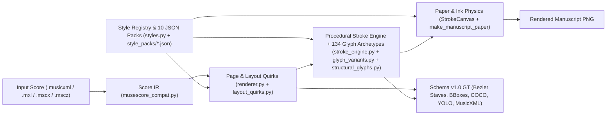

# Architecture — `hw-score-sim`

`hw-score-sim` is a pure-Python (`numpy` + `pillow`) procedural rendering engine that transforms symbolic music notation (`.musicxml`, `.mxl`, `.mscx`, `.mscz`) into photorealistic handwritten manuscripts paired with exact pixel-level ground truth.

Zero external engraving binaries (no MuseScore, no LilyPond, no Verovio, no Ghostscript) and zero scanned proprietary/NC font assets are used anywhere in the pipeline.

---

## End-to-End Pipeline

---

## Module Map

| Module (`src/hw_score_sim/`) | Responsibility |
|---|---|
| `musescore_compat.py` | **Parser & Score IR.** Parses MusicXML 3.1/4.0 (`.musicxml`, `.mxl`) and MuseScore 3/4 (`.mscx`, `.mscz`) into typed dataclasses (`ParsedScore`, `PartData`, `MeasureData`, `NoteEvent`, `RestEvent`, `TieSlurSpan`, `HairpinSpan`, `DynamicEvent`, `TempoEvent`, `VoltaBracket`). Handles multi-voice polyphony (voices 1–4), collision nudges, tuplets, articulations, ornaments, grace notes, lyrics, mid-measure clef/key/time changes, 8va/8vb clefs, and MusicXML export. |
| `styles.py` + `style_packs/*.json` | **Scribe Style Registry.** Holds 20 built-in core styles and auto-discovers 214 additional styles across 11 JSON packs (234 total, including 75 flagship `hero_*` scribes). Supports multi-level `"extends"` inheritance with cycle detection, strict `REQUIRED_STYLE_KEYS` and numeric-bound validation, continuous style interpolation (`interpolate_styles`), and unbounded unseen-scribe generation (`sample_random_scribe`). |
| `layout_quirks.py` | **Paper Synthesis & Human Geometry.** Generates multi-scale procedural manuscript paper (`make_manuscript_paper` across 6 `PAPER_TYPES`: laid-paper grain, foxing/mottling, edge aging, reverse-side bleed-through, eraser smudges, stains). Computes curved rastrum staff splines, organic slope drift, non-uniform bar widths, end-of-bar cramming, and horizontal rhythmic spacing jitter. |
| `stroke_engine.py` | **Calligraphic Vector-Stroke Rasterizer.** Provides `StrokeCanvas` (float32 RGB canvas in `[0, 1]` with tileable 256×256 paper-tooth texture) and core primitives (`draw_calligraphic_polyline`, `draw_filled_blob`, `draw_staff_line`). Models broad/pointed nib angle (`nib_angle_deg`, `nib_min_ratio`), pressure taper, ink pooling at stroke endpoints, dry-brush dropout, split-nib artifacts, smooth bow wobble, and neuromuscular tremor. |
| `glyph_variants.py` | **Musical Glyph Archetypes.** Procedural vector generators for 18 notehead archetypes (including ultra-slim needle/hairline/pinprick forms), 18 stem archetypes, 20 flag archetypes, 14 beam archetypes, 10 quarter/eighth/etc. rest archetypes, and 5 ledger-line styles, plus dots, ties, slurs, articulations, and dynamics. |
| `structural_glyphs.py` | **Structural Glyph Archetypes.** Self-contained registry of 54 structural variants: 18 clef archetypes (G, F, C, G8vb, G8va), 18 key-signature & accidental archetypes (`#`, `b`, natural, double sharp/flat, plus cluster spacing and drift), and 18 barline archetypes (single, double, final, repeat start/end/both). |
| `renderer.py` | **Page Orchestrator & Ground-Truth Emitter.** Runs `layout_score_pages` and `render_score_handwritten` (aliased as `render_score`): synthesizes paper, rules curved staves, resolves beams/stems/slurs/hairpins/lyrics, composites all strokes onto `StrokeCanvas`, saves the PNG, writes companion Ground-Truth JSON, and optionally exports cropped per-system strips with exact MusicXML targets. |
| `cli.py` | **CLI Entrypoints.** Implements `hw-score-sim` (single/batch rendering + `--list-styles` + `--export-train-dir`) and `hw-score-gallery` (parallel HTML eyeball galleries in `scores`, `stems-flags`, and `structural` modes). |

---

## Determinism & Reproducibility Contract

Every visual and geometric decision in `hw-score-sim` is driven by caller-supplied seeds:

- **Zero hidden global RNG state:** Paper grain, rastrum curvature, bar width variance, glyph wobble, tremor, dropout, rest-archetype draws, and marginalia all draw from explicit `numpy.random.Generator` and `random.Random` instances seeded from `seed`.
- **Bit-identical re-renders:** Calling `render_score(score_path, style_name, out_png, seed=42)` twice with the same inputs produces identical pixel arrays and identical Ground-Truth JSON.
- **Parallel safety:** Batch jobs (such as `hw-score-gallery` using `ProcessPoolExecutor`) assign an independent `seed + idx` per item so output never depends on worker scheduling order.

---

## Ground-Truth Schema v1.0

Each rendered page produces a companion `.json` sidecar (and in-memory payload) containing:

- **Page metadata:** `score_title`, `source_path`, `style`, `seed`, `page_w`, `page_h`.
- **System & staff geometry (`systems`):**
  - System measure range (`measure_start`, `measure_end`) and horizontal bounds.
  - Per-staff 5-line geometry: `part_index`, `part_name`, `sp` (staff space in pixels), `y_center`, and Bezier/spline control points (`ctrl_pts`) tracking exact rastrum curvature across the page.
  - Symbol-level bounding boxes and semantic labels for downstream object detection and sequence OMR.
- **ML Dataset Exporters:**
  - `to_coco_annotations(...)` converts rendered samples into standard MS-COCO detection dictionaries (`images`, `annotations`, `categories`).
  - `to_yolo_labels(...)` emits normalized `(class_id, cx, cy, w, h)` label lines.
  - `--export-train-dir` crops per-system strips and pairs each strip with an exact MusicXML slice (`export_score_to_musicxml`) for sequence-to-sequence / `bekern` training.

---

## Key Design Decisions

1. **Float32 linear-ish ink compositing on `StrokeCanvas`:** Ink strokes blend multiplicatively/alpha-weighted against a procedural paper-tooth tile rather than hard binary masks, yielding realistic graphite grain, iron-gall pooling, and marker overlap.
2. **Data-driven style packs with `"extends"`:** Keeping 139 scribe profiles in declarative JSON under `style_packs/` allows musicologists and ML practitioners to contribute new hands without touching Python code while enforcing strict validation on load.
3. **Permissive licensing by construction:** Because every pixel is mathematically generated from first-principles calligraphy and geometry equations, both the codebase and every generated training dataset are 100% MIT-licensed and free of `CC-BY-NC` or `GPL` restrictions.
